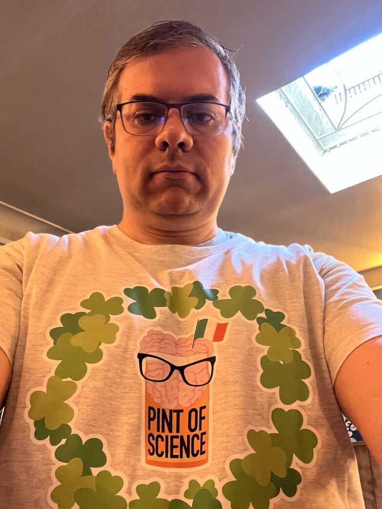

Last year, I stood at the back of the room at Pint of Science Galway, helping speakers set up their slides, taking photos of the audience, and watching scientists turn their research into stories the public could actually grab hold of.

This year, I'll be one of those holding the microphone.

On 18th May, I'll be speaking at Pint of Science 2026 in Galway (Massimo) with a talk titled "The Invisible Passenger: What Travels in Every Breath You Take." It's about the things we inhale without ever seeing them, and why a UAV flying overhead might know more about your air than you do.

Going from volunteer to speaker in one year feels strange to write down. Last May I was learning how the festival worked from the inside. This May I'll be trying to do justice to what I learned from the speakers I watched.

Huge thanks to SyMeCo and Lero for backing this work and making it possible to share with you.

If you're in Galway, come along. Pint of Science is at its best when the room is full and the conversation keeps going after the slides are off.

