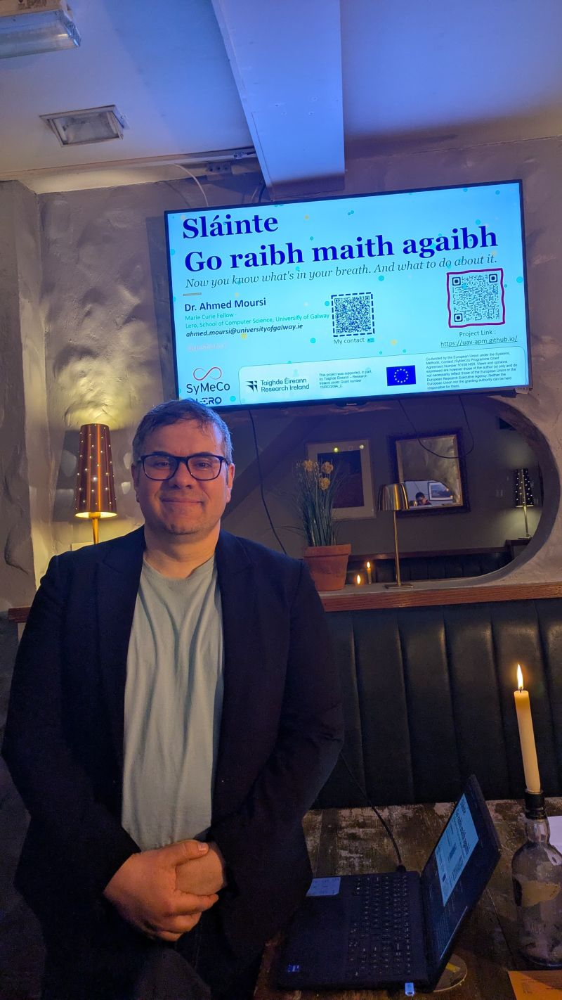
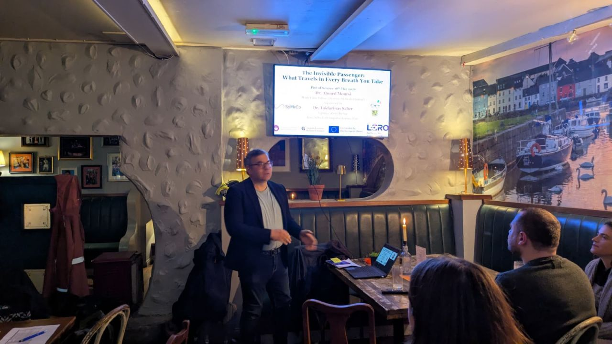
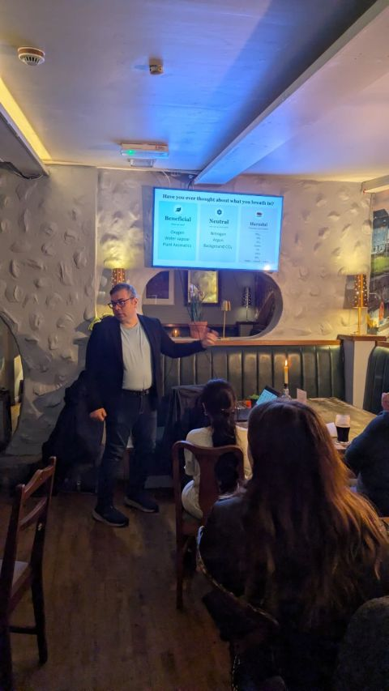
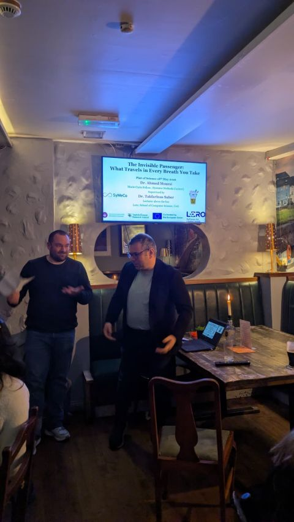

Last night I had the pleasure of giving my Pint of Science Ireland talk in Massimo, Galway: "The Invisible Passenger: What Travels in Every Breath You Take."

We took a closer look at the air we share, and what's actually in it. Every breath carries a mix of substances we can sort into three groups: the beneficial (oxygen and the gases that keep us alive), the neutral (mostly nitrogen, along for the ride), and the harmful (pollutants like PM2.5, NO₂, and ozone that quietly shape our long-term health).

From there we talked about how this links to my research at SyMeCo, Lero and the University of Galway School of Computer Science on UAV-based air quality assessment, and why bringing sensing closer to the source (above streets, near industrial sites) matters for the decisions communities make every day.

A huge thank you to my supervisor Takfarinas Saber and my secondment supervisor in the Irish EPA David Kelleghan for their support and for reviewing the presentation before the talk; your feedback made a real difference. And thank you to everyone who came out, asked sharp questions, and made the conversation so much fun.

Science is better with a pint and an audience.

PS: A huge thank you to Buddila Wijeyesekera for the photos.

