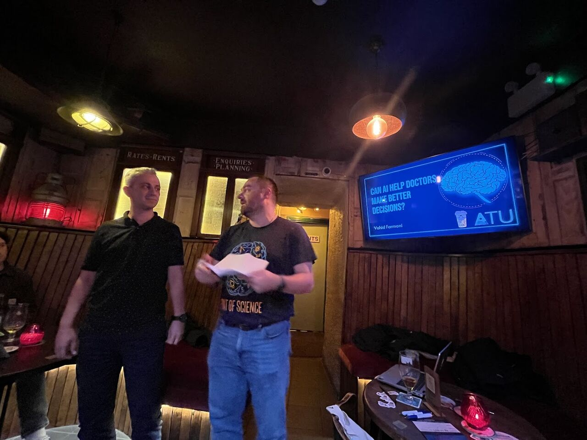
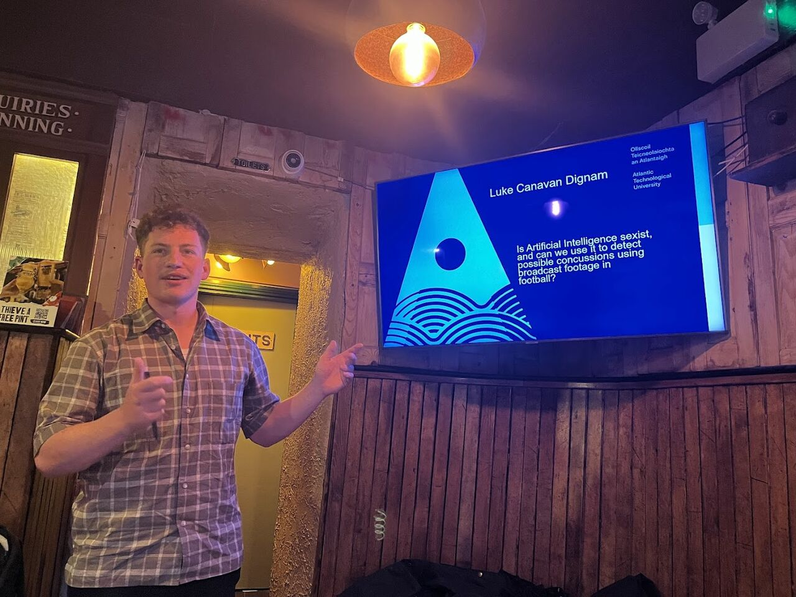
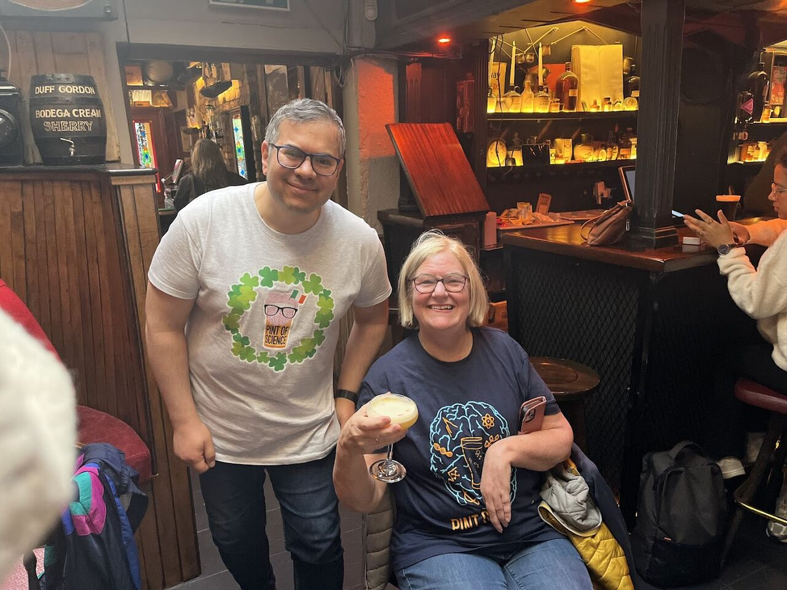
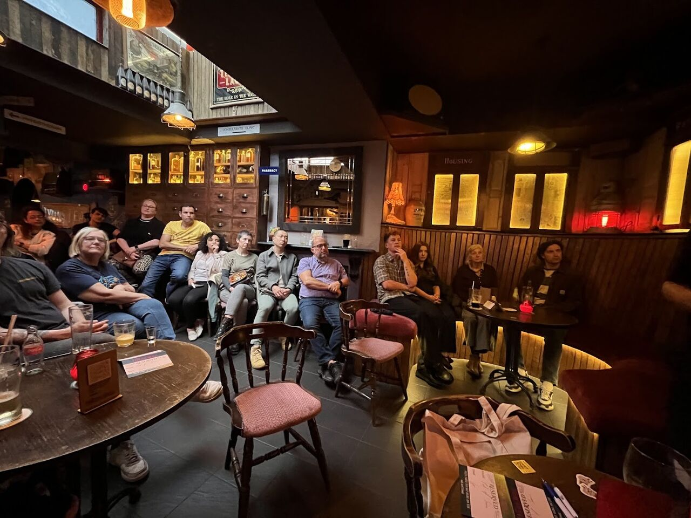
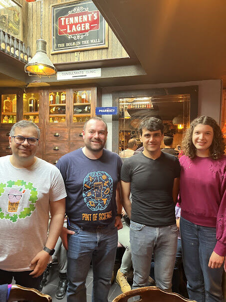
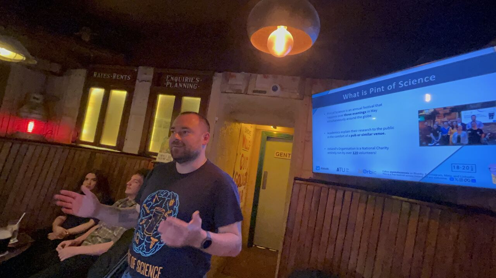

After speaking on Monday, I came back to Pint of Science Ireland, Galway as a volunteer on Tuesday and Wednesday in the Hole in the Wall pub, wanting to help communicate science from both sides this year.

Presenting takes real effort. Volunteering was a different kind of fun: watching other speakers shape their topics for a pub audience, and engaging with the questions people actually asked.

**Tuesday's evening, Mind, Body, and Belonging,** explored self-management of menstrual cycle symptoms (Rebecca Tarpey), how childhood maltreatment leaves traces in the adult brain (Andrea Fernandes), and the identity and behavioural dynamics of farm succession in Ireland (Noel Doyle). It was a window into parts of Irish culture and health I hadn't thought much about before.

**Wednesday's evening, Intelligence and Care,** looked at rehabilitation robots that learn by watching therapists (Ali Alabbas), a 3D cellular model of triple negative breast cancer (Maria Siegle), bias in AI for concussion detection in women's football (Luke Canavan Dignam), and machine learning to support stroke care decisions (Vahid F.).

A huge thank you to Dr. Trish O'Connell, co-director of Pint of Science, who came along on both nights I volunteered, and to Dr. Fiona Malone, who trained the speakers and joined us on Wednesday. Thanks also to Dr. Santiago Camblor-Perujo for presenting the speakers on Wednesday. And of course to all the speakers across both evenings: thank you for making it look easy (it isn't).

