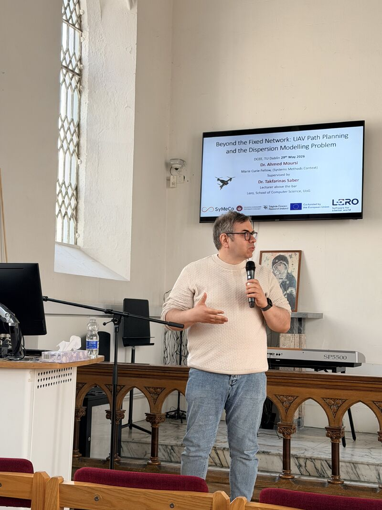
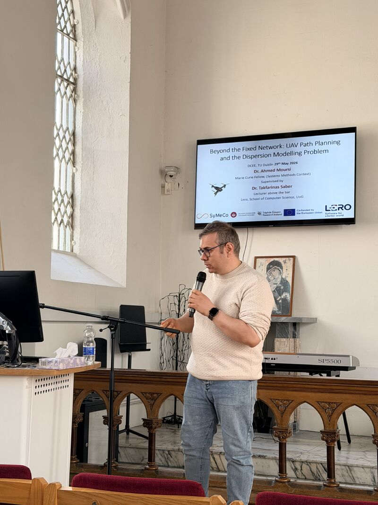
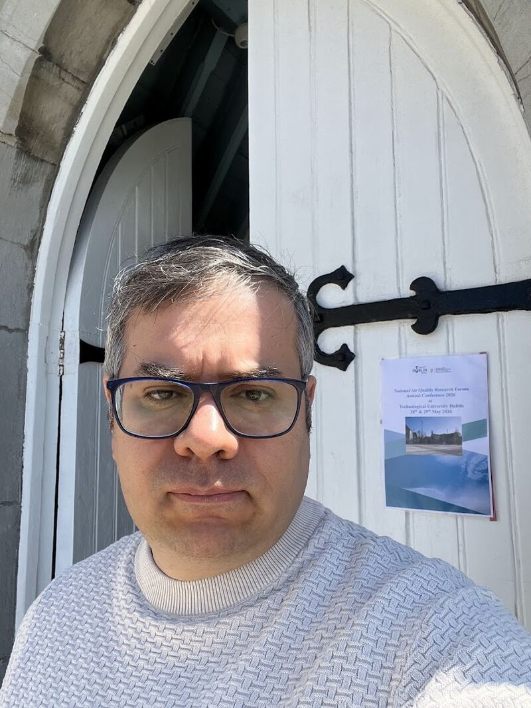

Last week I had the privilege of presenting at the DCEE National Air Quality Research Forum Annual Conference 2026 at TU Dublin, and it was a genuinely energising experience.

Being in that room was genuinely inspiring. My domain of expertise sits somewhere different, but what struck me was the sheer effort and care that everyone in that space brings to this work, from monitoring and modelling to policy and public health. That kind of dedication is hard not to be moved by.

I presented early-stage ideas around UAV path planning and atmospheric dispersion modelling in a talk titled "Beyond the Fixed Network: UAV Path Planning and the Dispersion Modelling Problem". This work is still taking shape, but I'm excited about it. The questions and conversations at the event were exactly the kind of feedback that sharpens your thinking and reminds you why you do this.

A special thank you to David Kelleghan at the EPA for recommending this event; it was exactly the right room to be in. And as always, I'm grateful for the continued support of my supervisor Takfarinas Saber, and the wider SyMeCo and Lero research communities at the University of Galway.

Grateful to the organisers (Pat Goodman, Eoin Mc Gillicuddy, Department of Climate, Energy and the Environment) for putting together such a thoughtful programme, and to everyone who engaged with me and my talk. A paper is in the works, so watch this space.

