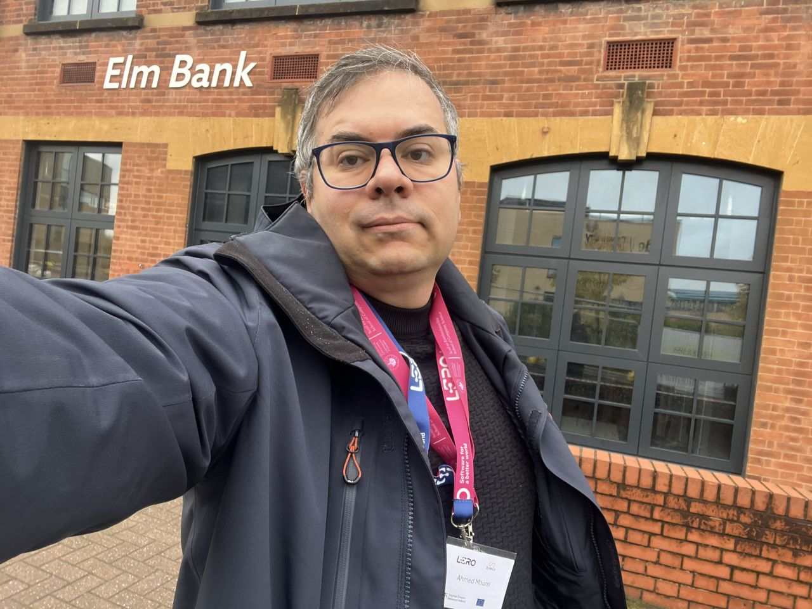
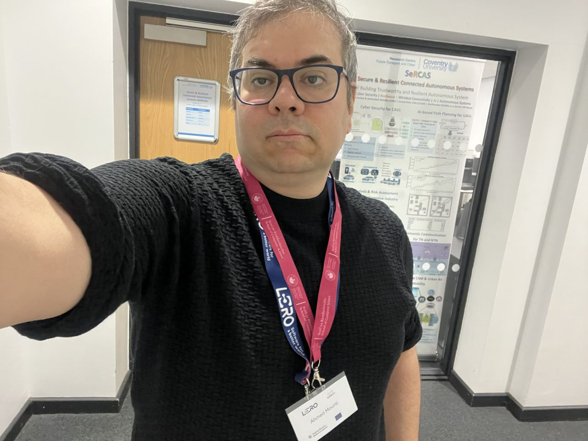
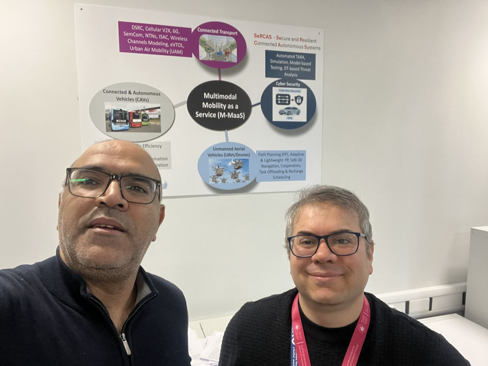
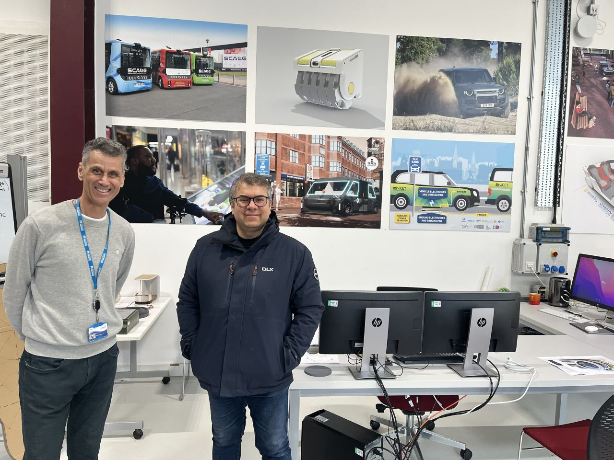
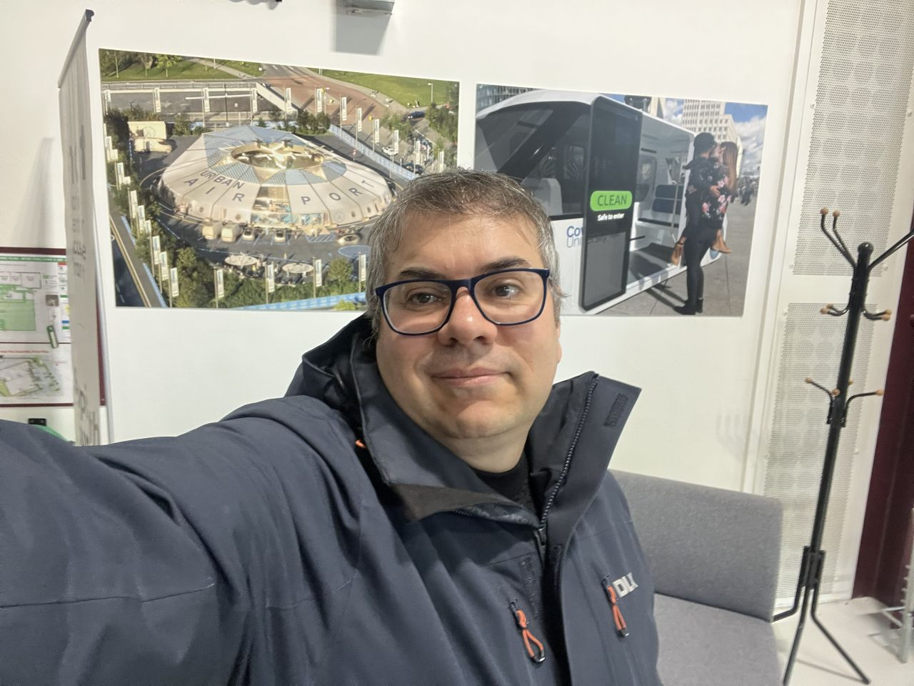
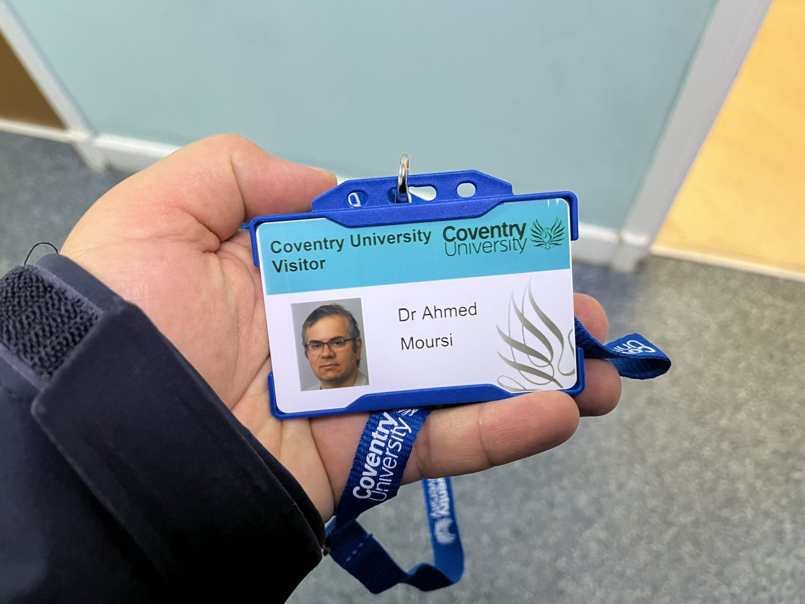

I had the pleasure of spending an inspiring first day at Coventry University as part of a scientific visit supported by SyMeCo, Lero and Research Ireland.

I would like to express my sincere gratitude to my PhD supervisor, Prof. Soufiene Djahel, for his warm welcome, generous hospitality, and the opportunity to explore his research laboratory and ongoing projects.

Prof. Soufiene introduced me to several fascinating research projects covering connected and autonomous vehicles, intelligent transportation systems, automotive cybersecurity, and other innovative research areas.

I was particularly interested in the research on securing Electronic Control Units (ECUs), often described as the electronic brains of modern vehicles. It was a valuable opportunity to learn about the ongoing work and technological challenges in intelligent and connected mobility.

I am equally grateful to Prof. Paul Herriotts for kindly hosting me at the National Transport Design Centre (NTDC) and sharing valuable insights into their approach to human-centred and inclusive transport design. Our discussions highlighted how accessibility, human factors, and user experience are essential considerations in developing future transportation solutions.

One of the highlights of the day was exploring the NTDC's impressive design and prototyping workshop, with its remarkable designs and physical prototypes.

I was particularly fascinated by the clay vehicle prototypes! It was new to me to discover how clay modelling continues to play an important role in automotive design, complementing advanced digital tools in shaping, evaluating, and refining vehicle designs. Seeing this combination of creativity, craftsmanship, and engineering was truly impressive.

It was also fascinating to learn about innovative projects involving autonomous electric shuttles, and urban air mobility, including the Air-One urban airport concept for future drone and electric vertical take-off and landing (eVTOL) operations.

**My key takeaway from Day 1:** The future of intelligent mobility is not only about connectivity, autonomy, and cybersecurity, but also about designing technologies around people, making transportation systems safer, more accessible, and more inclusive.

My special thanks also go to my supervisor in Ireland, Dr. Takfarinas Saber, for suggesting and encouraging this scientific visit and the opportunity to reconnect with my PhD supervisor, Prof. Soufiene Djahel.

I am equally grateful to SyMeCo, Lero, and Research Ireland for supporting this valuable opportunity for scientific exchange and strengthening academic connections.

Looking forward to the rest of this scientific visit!

