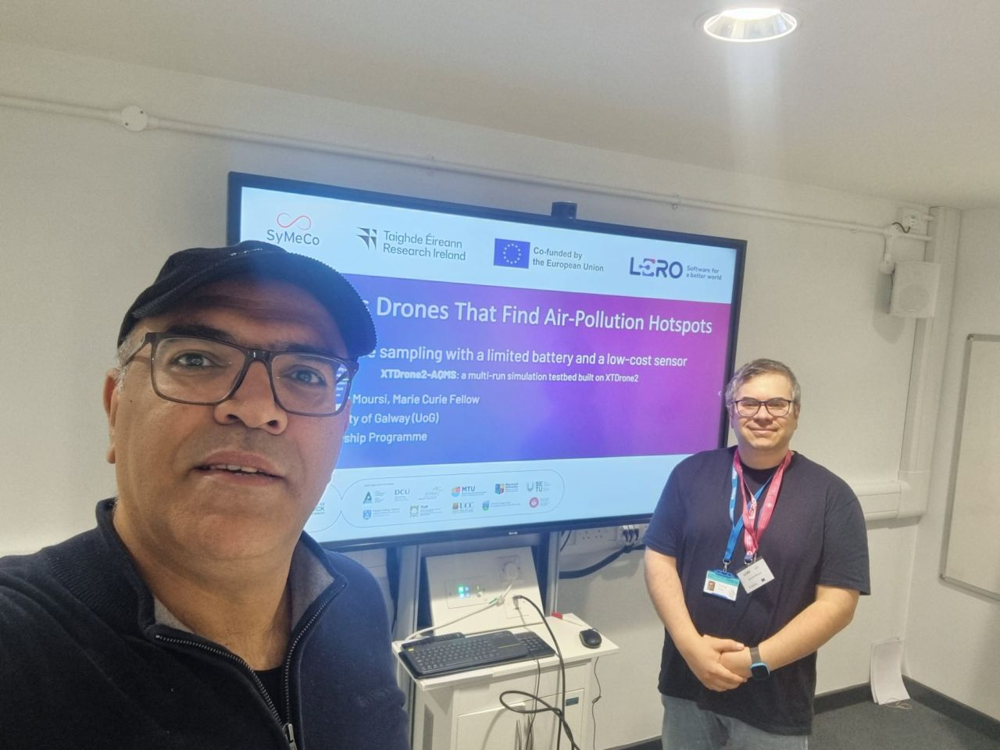
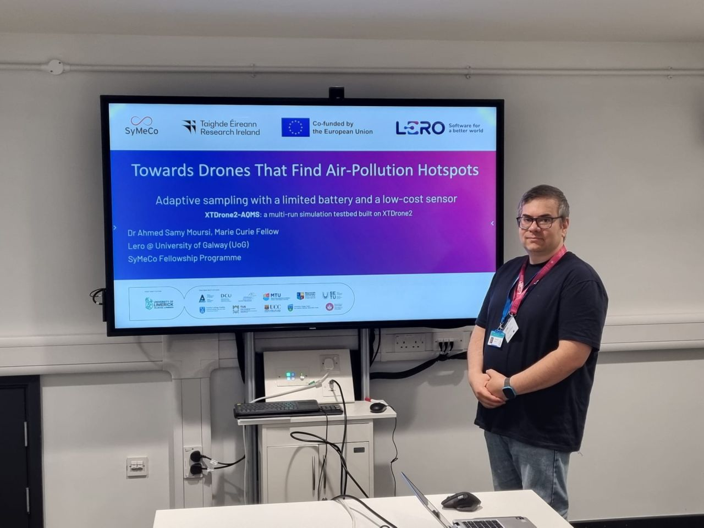

The second day of my scientific visit to Coventry University was dedicated to presenting and discussing my ongoing research with my PhD supervisor, Prof. Soufiene Djahel.

I had the opportunity to present my work, "Towards Drones That Find Air-Pollution Hotspots," including a demonstration of the simulation environment developed as part of the research.

It was a valuable experience to exchange ideas, discuss research challenges, and receive constructive feedback and fresh perspectives to help guide the next stages of my work.

I am sincerely grateful to Prof. Soufiene Djahel for his time, insightful discussions, and continued guidance and support.

My thanks also go to the SyMeCo Fellowship Programme, Lero, Research Ireland, and the European Union for supporting this scientific visit and fostering opportunities for academic collaboration.

