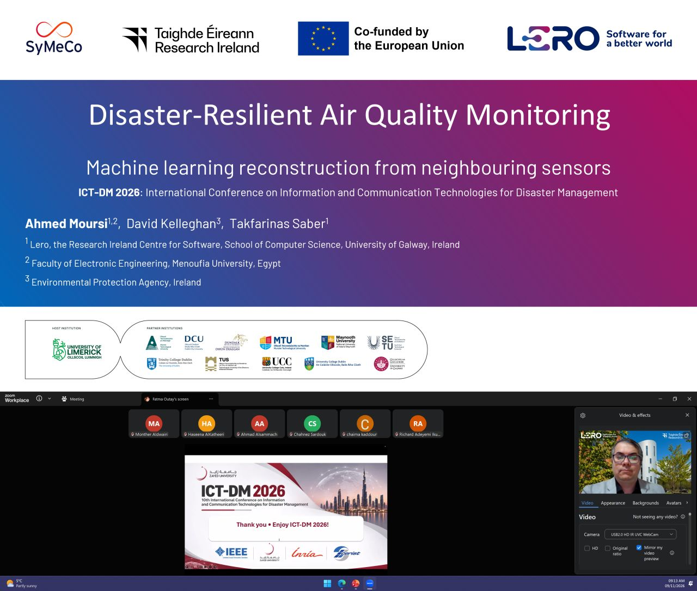

This week I presented our paper "[Disaster-Resilient Air Quality Monitoring: Machine Learning Reconstruction from Neighbouring Sensors](/publication/2026-11-10-disaster-resilient-air-quality-monitoring)" online at ICT-DM'2026, the International Conference on Information and Communication Technologies for Disaster Management, hosted in Dubai.

**The problem:** Air pollution is linked to about 8 million premature deaths a year. Floods, storms and power outages can knock monitoring stations offline just when emergency responders need the data most.

**Our approach:** We rebuild the missing readings from the stations that are still working, with no extra sensors. We used hourly data from four Delhi stations (2019–2025). Each station was hidden in turn, and we predicted its PM2.5 and NO₂ from the other three. We compared a BiLSTM and Extra Trees against a multi-station average baseline.

**What we found:** For PM2.5, both models beat the baselines at every station, and the BiLSTM did best. NO₂ is harder. The models beat the baseline at most stations, but local emission sources make some sites hard to predict.

The takeaway is that a sensor network can partly cover for its own failures, which helps keep air-quality information available during disasters.

Many thanks to my co-authors David Kelleghan (Irish EPA) and Takfarinas Saber, and to the ICT-DM'2026 organisers and session chair Prof. Dr. Yehya Mohamad.

This research was funded by Research Ireland through Lero, the Research Ireland Centre for Software. It was co-funded by the European Union through the SyMeCo (Systems, Methods, Context) programme at the University of Galway.

- Paper: [University of Galway Research Repository](https://research.universityofgalway.ie/en/publications/disaster-resilient-air-quality-monitoring-machine-learning-recons/)
- Slides: [PDF on GitHub](https://github.com/uav-apm/predict-lost-station-aq-ml/blob/main/docs/conference/ICT-DM26_Disaster-Resilient_AQ_Monitoring.pdf)
- Code: [uav-apm/predict-lost-station-aq-ml](https://github.com/uav-apm/predict-lost-station-aq-ml)
- Program: [ICT-DM 2026 programme](https://ict-dm.inria.fr/2026/program.html)

